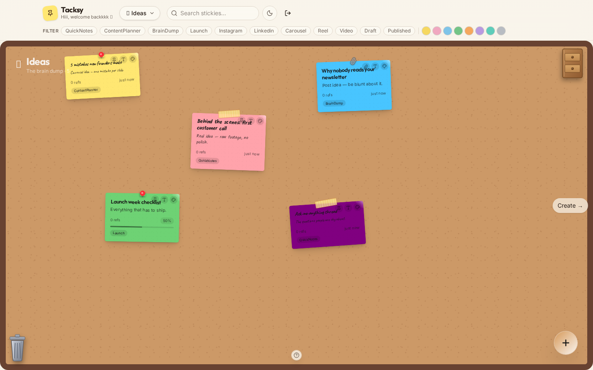

# Tacksy: Content Planning Cork-Board

A digital cork-board for planning content. Pin ideas, drag them from **Ideas → Create → Posted**, and track everything with sticky notes instead of a boring spreadsheet.

🔗 **Live:** [tacksy.xyz](https://www.tacksy.xyz)
👤 **My role:** Solo developer
🔒 **Source code:** Private. Happy to walk through it on a call.

## What I built
- Drag-and-drop board with three stages and persistent board state
- User accounts and per-user boards
- Animated, sticky-note style interface

## Tech stack
Django · React + TypeScript · Zustand · Framer Motion · PostgreSQL (Neon)
---
[All my work](https://github.com/iyendodaniel) · iyendodaniel4@gmail.com
